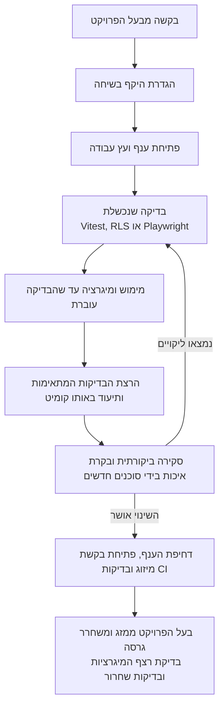

<div lang="he" dir="rtl">

# agent-tdd-starter

תבנית התחלה ליישומי ווב מקצה לקצה, שמפתחים סוכני קוד מבוססי בינה מלאכותית בשיטת
פיתוח מונחה בדיקות ובהובלת בעל הפרויקט. התבנית כוללת שיטת עבודה ויישום קטן שמדגים
אותה שלב אחר שלב.

- **משימות בענפים נפרדים**. לכל משימה יש ענף ועץ עבודה משלה, ובסופה נפתחת בקשת מיזוג (Pull Request).
- **בדיקות תחילה**. כותבים בדיקה לפני המימוש ומוודאים שהיא נכשלת מהסיבה הצפויה.
- **כללים במסד הנתונים**. מדיניות אבטחה ברמת השורה (RLS), הרשאות מפורשות ואילוצים נבדקים ישירות מול המסד.
- **סקירה ביקורתית**. סוכן שלא כתב את השינוי מנסה למצוא בו תקלות לפני שמכריזים שהוא אומת.
- **בקרת איכות (QA)**. במקביל לסקירה, סוכן נוסף משתמש ביישום בדפדפן אמיתי כמו משתמש רגיל.
  תוצאת הבדיקה וצילומי המסך מצורפים לבקשת המיזוג.
- **תיעוד באותו קומיט**. לכל תחום מסמך שמתאר את ההתנהגות הנוכחית ולצדו החלטות מתוארכות
  של בעל הפרויקט. בדיקה אוטומטית נכשלת כשמתגלה פער בין התיעוד לקוד.
- **שחרור בטוח של גרסאות**. בדיקה של רצף המיגרציות, קובצי סכמה שנוצרים אוטומטית ומושווים למסד
  בתהליך ה־CI, ומנגנון אחד לבדיקות לפני שחרור גרסה.

התבנית משתמשת ב־Next.js 16, ב־React 19, ב־TypeScript, ב־Tailwind CSS 4 עם shadcn על גבי
Base UI, ב־Supabase (כולל Postgres עם אבטחה ברמת השורה ושירות Auth), ב־Zod, ב־Vitest
וב־Playwright. סביבת העבודה מבוססת על pnpm ו־Node 24. שיטת העבודה מתאימה גם לטכנולוגיות
אחרות. הכללים הייחודיים למחסנית הזו מרוכזים בסעיף אחד ב־[AGENTS.md](AGENTS.md).

## פריסה עצמאית

[](https://vercel.com/new/clone?repository-url=https%3A%2F%2Fgithub.com%2FSivan22%2Fagent-tdd-starter&project-name=agent-tdd-starter&repository-name=agent-tdd-starter&stores=%5B%7B%22type%22%3A%22integration%22%2C%22integrationSlug%22%3A%22supabase%22%2C%22productSlug%22%3A%22supabase%22%7D%5D)

לחיצה אחת מקימה את כל הסביבה. היא יוצרת עותק של המאגר בחשבון GitHub שלכם,
פרויקט ב־Vercel שפורס כל שינוי שנדחף לענף `main`, ופרויקט Supabase דרך חנות האינטגרציות
של Vercel. השירות Vercel מגדיר אוטומטית את כתובת הפרויקט, את המפתחות ואת כתובת מסד
הנתונים. הבנייה הראשונה לסביבת הייצור מחילה את המיגרציות על המסד החדש.

נותרו שלוש הגדרות לביצוע. יש להגדיר את משתני Supabase לסביבת הייצור בלבד, להפנות את
Supabase Auth לכתובת היישום שלכם ולהחליט אם הרשמה מחייבת אימות בדוא״ל. ההוראות מופיעות
ב[מדריך הפריסה](docs/runbooks/deploy.md).

## תהליך העבודה

<div dir="ltr">



</div>

עץ העבודה נוצר בנתיב `.worktrees/<nnn>-<slug>`. המיזוג מתבצע אחרי שכל בדיקות ה־CI עוברות.

## התחלה מהירה

לפני שמתחילים, התקינו את Node 24, את pnpm 10, את Docker ואת `psql`, לקוח PostgreSQL
שמשמש את כלי הסכמה.

הריצו את הפקודות הבאות כדי להתקין את התלויות ואת Chromium לבדיקות מקצה לקצה,
להפעיל את Postgres, את Auth ואת Studio מקומית, ליצור קובץ `.env` מהסביבה הפעילה
ולהפעיל את שרת הפיתוח. הפורטים של Supabase מוגדרים ב־`supabase/config.toml`,
והיישום זמין ב־`http://127.0.0.1:3000`.

<div dir="ltr">

```bash
pnpm install
pnpm exec playwright install chromium
pnpm supabase start
bash scripts/local-env.sh
pnpm dev
```

</div>

להרצת הבדיקות השתמשו בפקודות הבאות.

| פקודה | מה היא בודקת |
| --- | --- |
| `pnpm tsc --noEmit` | בדיקת טיפוסים |
| `pnpm lint` | בדיקת קוד באמצעות ESLint |
| `pnpm test` | בדיקות יחידה, מדיניות RLS וכללי התיעוד באמצעות Vitest |
| `E2E_PORT=3100 pnpm test:e2e` | בדיקות מקצה לקצה באמצעות Playwright עם שרת פיתוח משלו |
| `pnpm db:check-schema` | התאמה בין קובצי הסכמה שנוצרו אוטומטית למסד הנתונים |
| `pnpm docs:check` | עמידה בכללי התיעוד |
| `bash scripts/security/scan-secrets.sh` | איתור סודות שנשמרו בקומיטים, עם מקרה ביקורת שלילי |
| `bash scripts/verify-release.sh <applied-mark>` | בדיקות שחרור הכוללות רצף מיגרציות, שמירה על מיגרציות שכבר שוחררו, בדיקת טיפוסים, ESLint, התאמת הסכמה למסד, Vitest ובנייה לסביבת הייצור |

## המשך קריאה

| מה תרצו לעשות | איפה לקרוא |
| --- | --- |
| לעבוד במאגר, כסוכן או כמפתח | [AGENTS.md](AGENTS.md) |
| לפתוח פרויקט משלכם מהתבנית | בחרו בכפתור «Use this template» ב־GitHub והמשיכו ל[מדריך לפתיחת פרויקט חדש](docs/runbooks/new-project.md) |
| לעבור על הדוגמה המלאה | [פתקים](docs/system/notes.md), `supabase/migrations/0001_notes.sql`, `tests/rls/notes.test.ts`, `tests/unit/note-input.test.ts`, `e2e/notes.spec.ts` |
| להבין איך התיעוד מאורגן | [מפתח התיעוד](docs/README.md) |
| לערוך סקירה ביקורתית | `.claude/agents/hostile-reviewer.md` |
| לערוך בקרת איכות | [מדריך בקרת האיכות](docs/runbooks/qa.md) |
| לשחרר גרסה | [מדריך שחרור גרסה](docs/runbooks/release.md) |

## מבנה המאגר

| נתיב | מה נמצא בו |
| --- | --- |
| `AGENTS.md`, `CLAUDE.md` | כללי העבודה שכל סוכן קורא לפני תחילת העבודה |
| `.claude/agents/hostile-reviewer.md` | הנחיות לסוכן הסקירה הביקורתית |
| `.claude/agents/qa-tester.md` | הנחיות לסוכן בקרת האיכות |
| `.github/workflows/ci.yml` | תהליך CI שכולל סריקת סודות, ביקורת תלויות והרצת כל הבדיקות מול סביבת Supabase זמנית |
| `.github/pull_request_template.md` | תבנית לצירוף תוצאות בדיקה וממצאים לבקשת מיזוג |
| `docs/` | מסמכי מערכת, החלטות, מדריכי תפעול, חומר עזר, קובצי סכמה ותבניות |
| `scripts/docs/` | הפקודות `docs:check`, `docs:gen` ו־`docs:owed` |
| `scripts/qa/` | הפקודה `qa:host`, שמפעילה את היישום ודפדפן אמיתי ומשאירה אותם פתוחים לסוכן בקרת האיכות |
| `scripts/*.sh` | בדיקות לרצף המיגרציות, יצירת קובצי סכמה ובדיקת התאמתם למסד, יצירת `.env` ובדיקות שחרור גרסה |
| `app/`, `components/`, `lib/` | יישום לדוגמה עם התחברות ופתקים פרטיים |
| `supabase/` | הגדרות לסביבה המקומית ומיגרציות ממוספרות |
| `tests/`, `e2e/` | בדיקות Vitest ו־Playwright |

## רישיון

[MIT](LICENSE)

</div>
